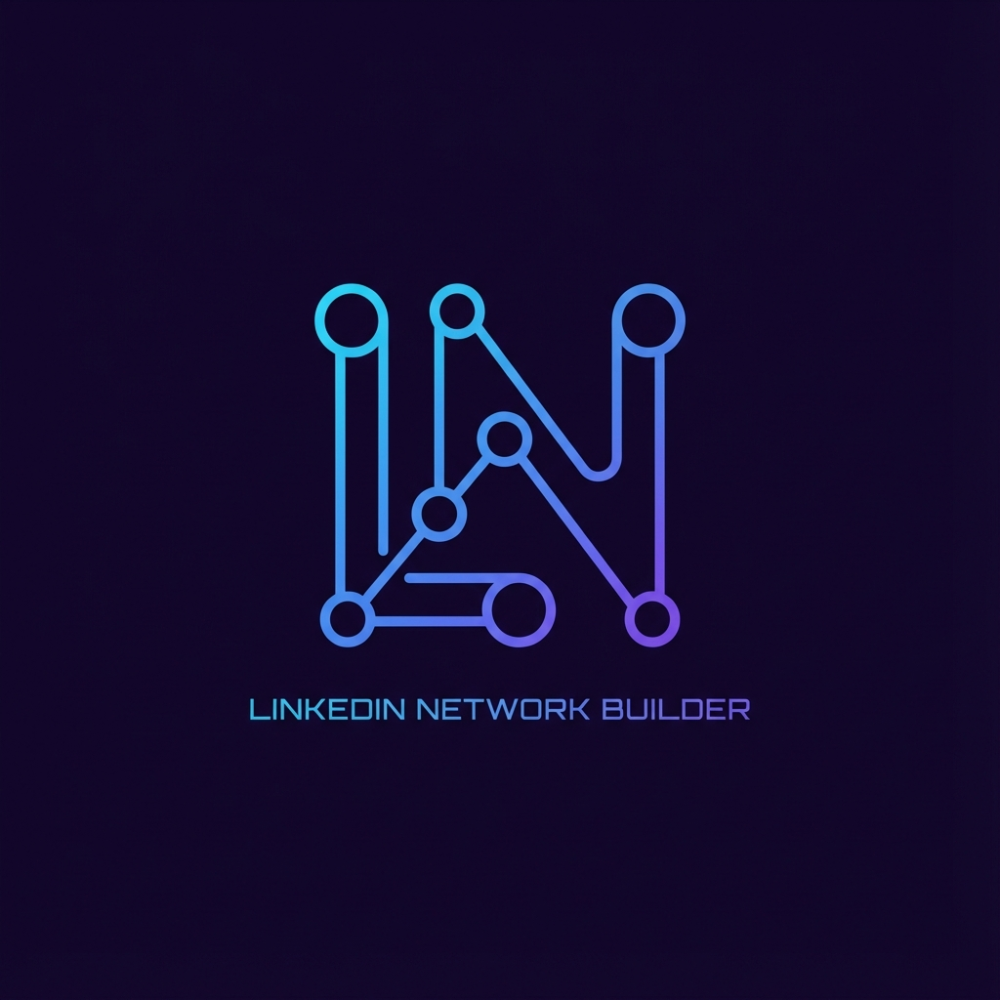

<div align="center">



# LinkedIn Network Builder

**A local dashboard for company- and role-based connection workflows.**


[Quick start](#quick-start) · [Workflow](#workflow) · [Project status](#project-status)

</div>

---

A Flask dashboard controlling a local Selenium/Chrome session. Enter a company, role, and request limit, sign in manually, and follow progress in the dashboard logs. This is an independent experiment, not an official LinkedIn application.

<a id="workflow"></a>

## ✨ Workflow

| Step | Behavior |
|---|---|
| Configure | Enter company, role, and a request count; the API accepts 1–50 |
| Sign in | Complete sign-in yourself in the local Chrome window |
| Process | The Selenium workflow searches and attempts connection actions |
| Monitor | Read dashboard logs and use Stop when needed |

The configured request count is an application limit, not a guarantee of platform permission or a platform-approved daily allowance. Review LinkedIn's applicable terms and any account restrictions before use.

<a id="quick-start"></a>

## 🚀 Quick start

Requires Python, Google Chrome, and a local graphical desktop. Install dependencies from [requirements.txt](requirements.txt):

```bash
git clone https://github.com/Vignesh-S-GitHub/Linkedin-Network-Build.git
cd Linkedin-Network-Build
python -m venv .venv
# macOS / Linux; Windows: .venv\Scripts\activate
source .venv/bin/activate
python -m pip install -r requirements.txt
python app.py
```

Open **http://localhost:5000**. Keep the server and browser window on your own computer. This application does not implement account authentication for its dashboard.

## 📁 Repository guide

| Path | Purpose |
|---|---|
| [app.py](app.py) | Start/stop/reset routes and in-memory logs |
| [bot/linkedin_bot.py](bot/linkedin_bot.py) | Browser session and connection workflow |
| [templates/index.html](templates/index.html) | Dashboard controls |
| [static/](static/) | Existing logo, styling, and client behavior |

<a id="project-status"></a>

## 🧩 Project status

The repository contains the local automation implementation but no automated tests. Browser selectors and site behavior can change. Persistent Chrome session data remains local to the machine.

The Reset handler currently references `os` without importing it in `app.py`, so that action can fail. Its intended Windows behavior also terminates Chrome processes; use Stop for the ordinary workflow.

## 🤝 Contributing

Open an issue with a reproducible example or submit a focused pull request. Keep setup instructions and documentation aligned with any behavior changes.

## 📄 License

No repository-level `LICENSE` file is currently included.
